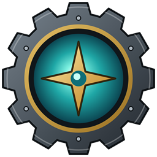
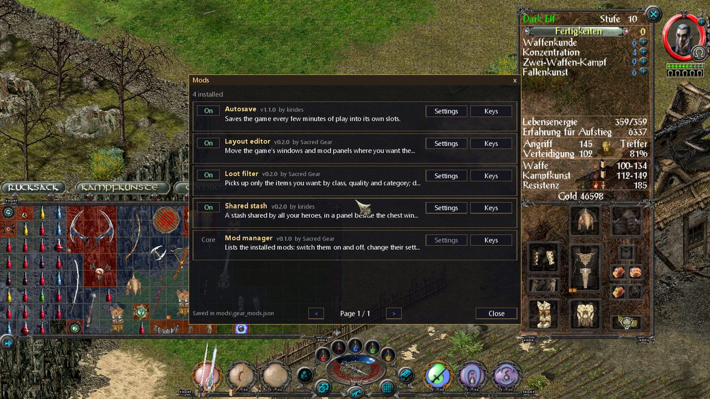
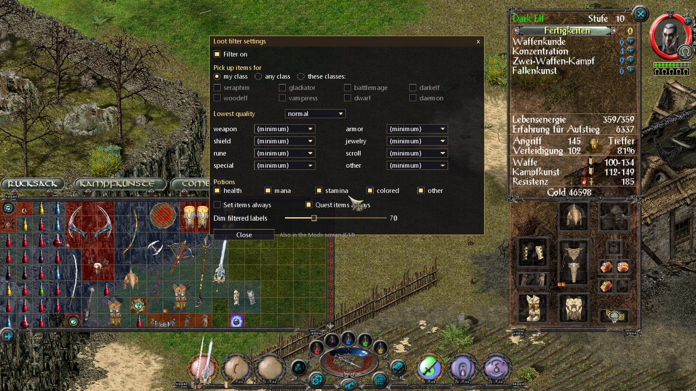
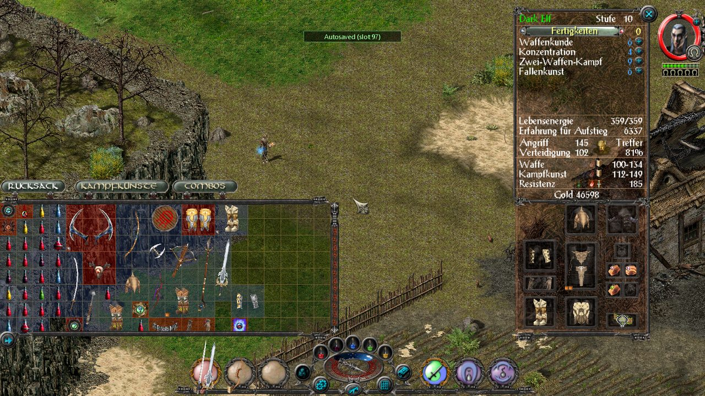

# SacredBild

<a href="https://kirides.github.io/sacred-bild/add-to-mod-manager.html?index=https%3A%2F%2Fraw.githubusercontent.com%2Fkirides%2Fsacred-bild%2Fmain%2Fmod-index.json"> </a>
<!-- GitHub strips gear-mod-manager:// links, so the button opens an https page that hands the link to the manager (docs/add-to-mod-manager.html in sacred-bild). -->
Have the [Gear Mod Manager](https://github.com/kirides/sacred-mod-manager)? Press the button to add this repository's index as a source (it asks first).

**Sacred Gold, made to run and play like it is not 2004.** SacredBild and Sacred Gear are two drop-in DLLs for the
GOG / Steam Sacred Gold (also the German build and Sacred ReBorn). You copy them into the game folder; nothing else
about your install changes.

> **AI disclosure:** SacredBild is developed with an AI coding assistant (Anthropic's Claude). Most of the code,
> the reverse engineering notes and this documentation were written with it, at the maintainer's direction; the
> maintainer decides what goes in and tests the changes in the game. The source is kept to what the features need
> and documented so that people can review it: see [Development](docs/Development.md).

## SacredBild (`ddraw.dll`)

A `ddraw.dll` that runs the game's DirectDraw / Direct3D 7 on its own Direct3D 9Ex backend and patches the game's
internals (the approach of [GD3D11](https://github.com/kirides/GD3D11) for Gothic).

- **Your monitor's resolution**: 1440p, 4K, ultrawide. The world shows more at its original sharpness, the 1024x768
  interface is scaled into a centered canvas and the HUD windows sit at the screen edges. Also: input only while the
  game is in the foreground, the cursor kept in the window, drawing in the background, a frame limiter that doesn't
  spin, full-screen screenshots. See [Display, UI and input](docs/Display.md).
- **Smooth frame rates**: merged draw calls, the ground kept on the GPU, characters skinned on the GPU and animated on
  several threads, SMAA, movies through Media Foundation; frame statistics, a profiler and crash dumps. See
  [Rendering](docs/Rendering.md).
- **Controller support** (Xbox, PlayStation, Switch; through SDL3): walking with the stick, aim-assisted attacks and
  combat arts, a cursor and D-pad navigation for menus and windows, button prompts on screen, bindings set in game. See
  [Controller](docs/Controller.md).
- **Multiplayer that works today**: LAN games over VPNs, the game connection over UDP instead of TCP, and a matchmaker
  that lists everyone's games in the LAN list and connects players without port forwarding (IPv4 and IPv6). See
  [Multiplayer](docs/Multiplayer.md).
- **Any language**: one install runs every language you have the text and speech files for. See
  [Languages](docs/Languages.md).

Every setting is in the settings window before the game starts and in `SacredBild.ini`: [Configuration](docs/Configuration.md).

## Sacred Gear (`SacredGear.dll`)

Sacred Gear lets the game run **mods** (small Lua scripts). It works with SacredBild or on its own.

**Mod manager** (F11, or *Mods* under the escape menu): every installed mod, on or off, its settings and its keys,
with a warning when two mods want the same key.



**Layout editor**: hold **Alt** and click *Edit layout* at the top left. Drag any game window or mod panel anywhere; it
snaps to screen edges and other windows, the arrow keys nudge it, and the layout is remembered.


**Loot filter** (F5): your hero picks up only what is worth it, by class, quality, category and potion type; filtered
items' labels are dimmed so the good drops stand out.



**Shared stash**: one stash for all your heroes, opened with the chest, items kept with their properties and runes.


**Autosave**: saves every few minutes of play into its own slots 97 to 99, oldest first; F6 saves right now.



The mods live in [sacred-gear-mods](https://github.com/kirides/sacred-gear-mods), each with a page:
[Loot filter](https://github.com/kirides/sacred-gear-mods/blob/main/docs/mods/lootfilter.md), [Loot log](https://github.com/kirides/sacred-gear-mods/blob/main/docs/mods/lootlog.md), [Damage meter](https://github.com/kirides/sacred-gear-mods/blob/main/docs/mods/damagemeter.md), [Session tracker](https://github.com/kirides/sacred-gear-mods/blob/main/docs/mods/sessiontracker.md), [Layout editor](https://github.com/kirides/sacred-gear-mods/blob/main/docs/mods/layout.md), [Realm picker](https://github.com/kirides/sacred-gear-mods/blob/main/docs/mods/realms.md), [Autosave](https://github.com/kirides/sacred-gear-mods/blob/main/docs/Autosave.md), [Shared stash](https://github.com/kirides/sacred-gear-mods/blob/main/docs/SharedStash.md), [Better SaveLoad](https://github.com/kirides/sacred-gear-mods/blob/main/src/better-saveload/README.md), [Drop tuning](https://github.com/kirides/sacred-gear-mods/blob/main/docs/DropTuning.md), [Auction house](https://github.com/kirides/sacred-gear-mods/blob/main/src/auction-house/README.md), [Achievements](https://github.com/kirides/sacred-gear-mods/blob/main/docs/mods/achievements.md), [Bounty board](https://github.com/kirides/sacred-gear-mods/blob/main/docs/mods/bounty.md), [Build sharer](https://github.com/kirides/sacred-gear-mods/blob/main/docs/mods/buildsharer.md), [Quest helper](https://github.com/kirides/sacred-gear-mods/blob/main/docs/mods/questhelper.md), [Server feed](https://github.com/kirides/sacred-gear-mods/blob/main/docs/mods/serverfeed.md), [Twitch Integration](https://github.com/kirides/sacred-gear-mods/blob/main/docs/mods/twitch_integration.md).
The easiest way to get them: extract `sacred-gear-mods-<version>.zip` from the
[mods releases](https://github.com/kirides/sacred-gear-mods/releases/latest) into the game folder and delete the mods
you do not want. Writing your own: [Sacred Gear](docs/Gear.md).

## Install

Download a [release](../../releases) (tagged versions, and a nightly prerelease of every push to `main`) and extract
the zip into the game folder. It replaces the `ddraw.dll` there (if that is DDrawCompat, move it to
`SacredBild\DDrawCompat.dll` first) and an existing `SacredBild.ini`. `SacredGear.dll` next to the game is loaded by
SacredBild; other loaders: [Sacred Gear, Install](docs/Gear.md#install). Mods go into `mods`.

From a build (see [Build](docs/Development.md#build)):

```powershell
.\install.ps1 -GameDir "B:\Spiele\GOG Games\Sacred Gold"
```

This backs up the current `ddraw.dll`, moves an existing DDrawCompat to `SacredBild\DDrawCompat.dll`, copies
SacredBild's `ddraw.dll` and creates `SacredBild.ini` if there is none. `uninstall.ps1` restores the backup.

- **Steam**: its `Sacred.exe` is the English GOG exe inside Steam's DRM wrapper (SteamStub); SacredBild starts once
  the wrapper has decoded the game's code.
- **Wine / Proton**: SacredBild's `ddraw.dll` only loads with a native override, `WINEDLLOVERRIDES="ddraw=n,b"`.
- **Another `d3d9.dll`** (e.g. [DXVK](https://github.com/doitsujin/dxvk)'s 32-bit one): `[DDraw] D3D9`, or put it next
  to the game exe. **DDrawCompat** instead of SacredBild's backend: `[DDraw] Backend=chain`. See
  [Rendering](docs/Rendering.md#direct3d-9ex-backend).

## Supported games

- The **English** GOG `Sacred.exe` (PE timestamp `0x452F85C7`) and the **German** `sacred.exe` 2.0 (`0x451BBE74`),
  with their `gameserver.exe`. SacredBild finds what it patches by byte signatures, not fixed addresses, so other
  builds with the same code should work too; if a signature isn't found, it passes the ddraw calls through and logs
  which one.
- **Sacred ReBorn** (`SacredReborn.exe`, the German build with patched code). It sets its resolution itself
  (`SR_HD_WIDTH` / `SR_HD_HEIGHT` with `SR_HD_ENABLE`, or `SR_WIDTH` / `SR_HEIGHT`, in `Settings.cfg`, set by its config
  tool); SacredBild's `[Display] Width` / `Height` apply when those are unset, and the UI scaling and the other modules
  work on top. ReBorn loads the language files from disk, so there is no language import. Install into its folder like
  any other: `.\install.ps1 -GameDir "...\sacred gold ReBorn"`.

## Documentation

| Document | Contents |
|---|---|
| [Configuration](docs/Configuration.md) | The settings window and every key of `SacredBild.ini` |
| [Display, UI and input](docs/Display.md) | Resolution, UI canvas and HUD layout, resizable window, screenshots, focus and cursor, frame limits |
| [Rendering](docs/Rendering.md) | The Direct3D 9Ex backend, movies, batching, ground and characters on the GPU, SMAA, diagnostics |
| [Controller](docs/Controller.md) | Button layout, menus and windows, button prompts, controller settings |
| [Multiplayer](docs/Multiplayer.md) | LAN games over VPNs, the UDP connection, online games through the matchmaker |
| [Languages](docs/Languages.md) | Text and speech of other languages, `import-language.ps1` |
| [Sacred Gear](docs/Gear.md) | The mod kit: install, writing a mod, the file overlay, the mod manager, automation |
| [Gear API reference](docs/GearApi.md) | Every function, option and event a mod can use (generated from `gear/meta`) |
| [Gear drops](docs/GearDrops.md) | `gear.drops`: how the engine rolls drops and what each setting changes |
| [Custom classes](docs/CustomClasses.md) | `gear.classes`, `gear.models`, ability copies: what the engine binds to a hero class, and which arts work on which body |
| [Gear in network games](docs/GearMultiplayer.md) | Sacred's multiplayer messages, the mod channel, `gear.net` channels |
| [Development](docs/Development.md) | Source files, tools, the game-launch lock, build; Sacred Gear's sources and API annotations |
| [RE notes](docs/RE_NOTES.md) | What the game's code does, as far as SacredBild and Sacred Gear need it |
| [UI system](docs/UI_SYSTEM.md) | The game's UI manager: windows, named UI events, event and draw order, focus |
| [UDP protocol](docs/UDP_PROTOCOL.md) | The UDP connection's and the matchmaker's wire formats |
| [Matchmaker](matchmaker/README.md) | Running a matchmaking server |

## Credits

SacredBild builds on:

- [Detours](https://github.com/microsoft/Detours) (hooks), [gtl](https://github.com/greg7mdp/gtl) (hash maps),
  [Dear ImGui](https://github.com/ocornut/imgui) (SacredBild's own screens), [SDL3](https://www.libsdl.org)
  (controllers), [KCP](https://github.com/skywind3000/kcp) (the UDP connection) and [LuaJIT](https://luajit.org)
  (Sacred Gear), linked in;
- [SMAA](https://github.com/iryoku/smaa) by Jorge Jimenez et al. (MIT, `src/ddraw9/smaa/`): the antialiasing;
- [Input Prompts](https://github.com/meritite-union/input-prompts) by the Meritite Union (CC0): the controller
  button images of the button prompts;
- [DDrawCompat](https://github.com/narzoul/DDrawCompat) and [DXVK](https://github.com/doitsujin/dxvk), which it can
  load (`[DDraw] Backend=chain`, `[DDraw] D3D9`);
- the approach of [GD3D11](https://github.com/kirides/GD3D11) for Gothic.
