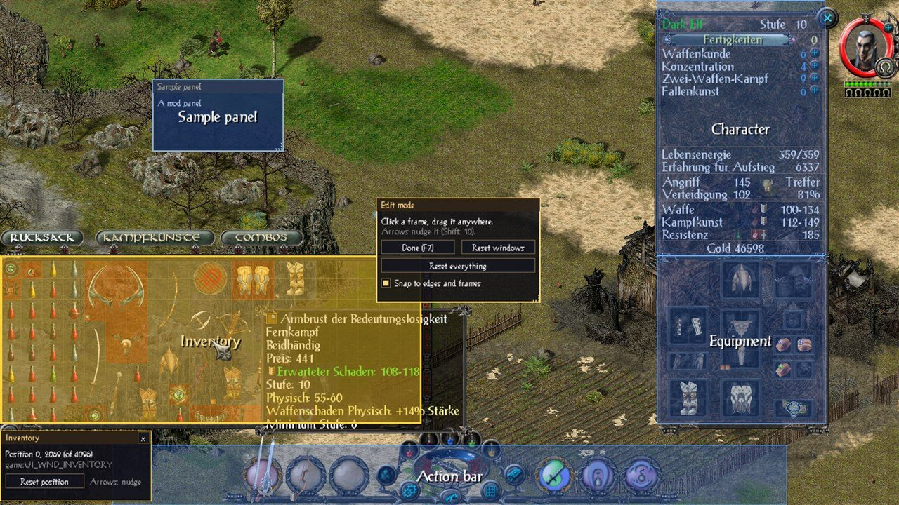
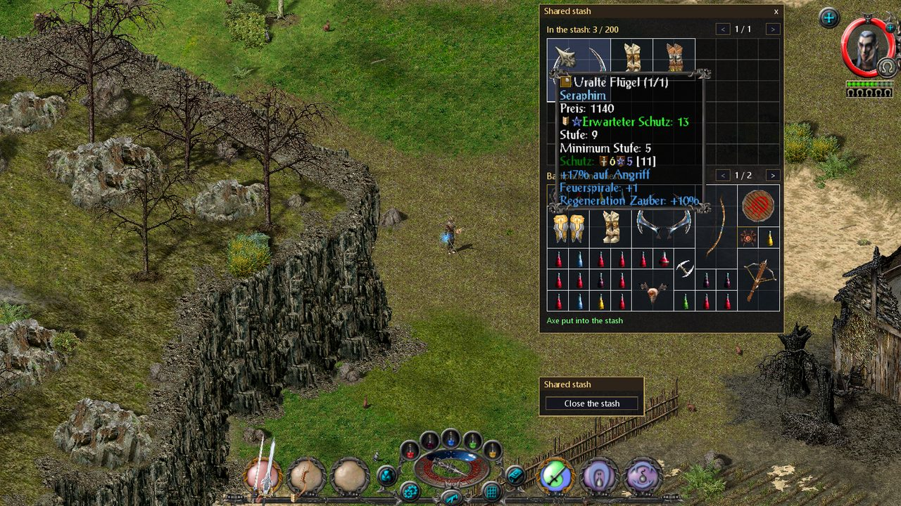

# SacredBild

**Sacred Gold, made to run and play like it is not 2004.** SacredBild and Sacred Gear are two drop-in DLLs for the
GOG / Steam Sacred Gold (also the German build and Sacred ReBorn). You copy them into the game folder; nothing else
about your install changes.

## For players

### What you get from SacredBild (`ddraw.dll`)

- **Your monitor's resolution**: 1440p, 4K, ultrawide. The world shows more at its original sharpness, and the old
  1024x768 interface is scaled and centered with its windows at the screen edges.
- **Smooth frame rates**: a new renderer (Direct3D 9Ex) with merged draw calls, the ground kept on the GPU and
  characters animated on several threads. Walking through a town with many characters no longer stutters.
- **Controller support**: Xbox, PlayStation and Switch pads: walk with the stick, aim-assisted attacks and combat arts,
  cursor and D-pad menus, button prompts on screen.
- **Multiplayer that works today**: LAN games over a VPN, a UDP connection instead of TCP, and a matchmaker so friends
  can find and join your game without port forwarding.
- **Any language**: one install runs every language you have text and speech files for.
- Small things that add up: input only while the game is focused, the cursor kept in the window, a frame limiter
  that does not burn a CPU core, full-screen screenshots, crash dumps.

### What you get from Sacred Gear (`SacredGear.dll`)

Sacred Gear lets the game run **mods** (small Lua scripts) and ships with some. It works with SacredBild or on its own.

**Mod manager** (F11, or the *Mods* button under the escape menu): see every installed mod, switch each on or off,
change its settings and re-bind its keys, with a warning when two mods want the same key.


**Layout editor** (F7), like the edit mode of an MMO: every game window and mod panel gets an overlay; click one and
drag it anywhere, it snaps to screen edges and to other windows, the arrow keys nudge it, and your layout is
remembered.



**Loot filter** (settings in game with F5): your hero picks up only what is worth it: items for its class, above a
quality you choose, per category (weapons, armor, jewelry, runes, ...) and per potion type. Filtered items' labels
are dimmed so the good drops stand out.


**Shared stash** (F10, from the extra mods): one stash for all your heroes. Put an item in with one hero, take it
out with another, with its random properties and runes intact.



**Autosave** (F6, from the extra mods): saves your game periodically, so a crash or a
bad fight costs minutes, not an hour.

The loot filter and the layout editor are in this repository (`gear/examples`); the shared stash, the autosave and
more are in [sacred-gear-mods](https://github.com/kirides/sacred-gear-mods). A mod is a folder in the game's `mods`
folder: copy it in, press F11, switch it on. Writing your own is covered in [Sacred Gear](docs/Gear.md).

### Install

Download a [release](../../releases) (tagged versions, plus a nightly of every push to `main`) and extract the zip
into the Sacred Gold folder. `SacredGear.dll` next to the game loads with SacredBild. Mods go into `mods`. The
[Install](#install-1) section below has the details, Steam, Wine and DDrawCompat included.

---

## Technical overview

> **AI disclosure:** SacredBild is developed with an AI coding assistant (Anthropic's Claude). Most of the code,
> the reverse engineering notes and this documentation were written with it, at the maintainer's direction; the
> maintainer decides what goes in and tests the changes in the game. The source is kept to what the features need
> and documented so that people can review it: see [Development](docs/Development.md).

A `ddraw.dll` hook for **Sacred Gold** that runs the game at modern resolutions and instruments its
renderer, as groundwork for replacing the slow parts. It runs the game's DirectDraw / Direct3D 7 on Direct3D 9Ex
itself (or loads [DDrawCompat](https://github.com/narzoul/DDrawCompat) behind itself, `Backend=chain`), and patches
the game's internals (the approach of [GD3D11](https://github.com/kirides/GD3D11) for Gothic).

Supported executables: the **English** GOG `Sacred.exe` (PE timestamp `0x452F85C7`) and the **German**
`sacred.exe` 2.0 (`0x451BBE74`), with their `gameserver.exe`. SacredBild finds what it patches by byte signatures, not
fixed addresses, so other builds with the same code should work too; if a signature isn't found, it only passes
ddraw calls through and logs which one.

**Sacred ReBorn** (`SacredReborn.exe`, the German build with patched code) is supported too. It patches the
game's resolution code itself (`SR_HD_WIDTH` / `SR_HD_HEIGHT` with `SR_HD_ENABLE`, or `SR_WIDTH` / `SR_HEIGHT`, in `Settings.cfg`, set by its config tool); SacredBild's
`[Display] Width` / `Height` (default: the screen) is the size when those are unset, and the UI scaling and the
other modules work on top of it. ReBorn loads the language files from disk, so there is no language import. Install into its folder like any
other: `.\install.ps1 -GameDir "...\sacred gold ReBorn"`.

## What it does

- **Any resolution and a scalable UI**: the world shows more at its original pixel density, the 1024x768 UI is
  scaled into a centered canvas, and the HUD windows sit at the screen edges. Also: input only while the game is in
  the foreground, the cursor kept in the window, drawing in the background, a frame limiter that doesn't spin, and
  full-screen screenshots. See [Display, UI and input](docs/Display.md).
- **Faster rendering**: DirectDraw / Direct3D 7 on SacredBild's own Direct3D 9Ex backend, the world's draw calls
  merged, the ground kept on the GPU, characters skinned on the GPU and animated on several threads, movies through Media Foundation, frame statistics, a profiler and crash
  dumps. See [Rendering](docs/Rendering.md).
- **Controller** (Xbox, PlayStation, Switch; through SDL3): walking with the stick, aim-assisted attacks and combat
  arts, a cursor and D-pad navigation for menus and windows, button prompts on screen, bindings set in game. See
  [Controller](docs/Controller.md).
- **Multiplayer**: LAN games over VPNs, the game connection over UDP instead of TCP, and a matchmaker that lists
  everyone's games in the LAN list and connects players without port forwarding (IPv4 and IPv6). See
  [Multiplayer](docs/Multiplayer.md).
- **Languages**: one install runs every language you have the text and speech files for. See
  [Languages](docs/Languages.md).

## Install

From a [release](../../releases) (tagged versions, and a nightly prerelease of every push to `main`): extract the
zip into the game folder. It replaces the `ddraw.dll` there (if that is DDrawCompat, move it to
`SacredBild\DDrawCompat.dll` first) and an existing `SacredBild.ini`.

The Steam version works the same way: its `Sacred.exe` is the English GOG exe inside Steam's DRM wrapper
(SteamStub), and SacredBild starts once the wrapper has decoded the game's code.

From a build (see [Build](docs/Development.md#build)):

```powershell
.\install.ps1 -GameDir "B:\Spiele\GOG Games\Sacred Gold"
```

This backs up the current `ddraw.dll`, moves an existing DDrawCompat to `SacredBild\DDrawCompat.dll`,
copies SacredBild's `ddraw.dll` and creates `SacredBild.ini` if there is none. `uninstall.ps1` restores the backup.
DDrawCompat is only used with `[DDraw] Backend=chain`; without it, that falls back to Windows' own `ddraw.dll`
(whose Direct3D 7 runtime refuses render targets over 2048 pixels; SacredBild works around that).

The Direct3D 9 backend runs on any `d3d9.dll`: `[DDraw] D3D9`, else a `d3d9.dll` next to the game exe (e.g.
[DXVK](https://github.com/doitsujin/dxvk)'s 32-bit one), else Windows' own. `SacredBild.log` names the one in use
(`Direct3D 9: using ...`). Under Wine / Proton, SacredBild's `ddraw.dll` only loads with a native override:
`WINEDLLOVERRIDES="ddraw=n,b"`.

## Documentation

| Document | Contents |
|---|---|
| [Configuration](docs/Configuration.md) | The settings window and every key of `SacredBild.ini` |
| [Display, UI and input](docs/Display.md) | Resolution, UI canvas and HUD layout, screenshots, focus and cursor handling, frame limits |
| [Rendering](docs/Rendering.md) | The Direct3D 9Ex backend, movies, batching, GPU skinning, diagnostics |
| [Controller](docs/Controller.md) | Button layout, menus and windows, button prompts, controller settings |
| [Multiplayer](docs/Multiplayer.md) | LAN games over VPNs, the UDP connection, online games through the matchmaker |
| [Languages](docs/Languages.md) | Text and speech of other languages, `import-language.ps1` |
| [Development](docs/Development.md) | Reading the code, source files, tools, build |
| [RE notes](docs/RE_NOTES.md) | What the game's code does, as far as SacredBild needs it |
| [UDP protocol](docs/UDP_PROTOCOL.md) | The UDP connection's and the matchmaker's wire formats |
| [Matchmaker](matchmaker/README.md) | Running a matchmaking server |
| [Sacred Gear](docs/Gear.md) | The LuaJIT mod kit, a separate DLL from this repository (works with or without SacredBild) |

## Credits

SacredBild builds on:

- [Detours](https://github.com/microsoft/Detours) (hooks), [gtl](https://github.com/greg7mdp/gtl) (hash maps),
  [Dear ImGui](https://github.com/ocornut/imgui) (SacredBild's own screens), [SDL3](https://www.libsdl.org)
  (controllers) and [KCP](https://github.com/skywind3000/kcp) (the UDP connection), linked in;
- [Input Prompts](https://github.com/meritite-union/input-prompts) by the Meritite Union (CC0): the controller
  button images of the button prompts;
- [DDrawCompat](https://github.com/narzoul/DDrawCompat) and [DXVK](https://github.com/doitsujin/dxvk), which it can
  load (`[DDraw] Backend=chain`, `[DDraw] D3D9`);
- the approach of [GD3D11](https://github.com/kirides/GD3D11) for Gothic.
