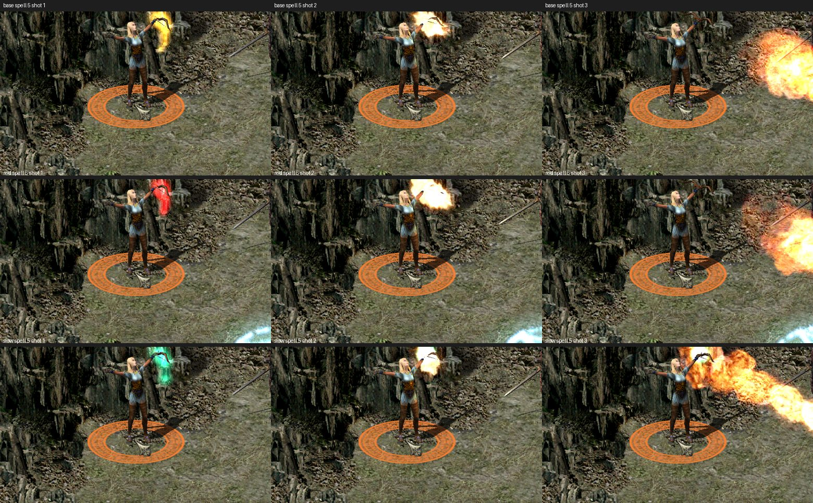
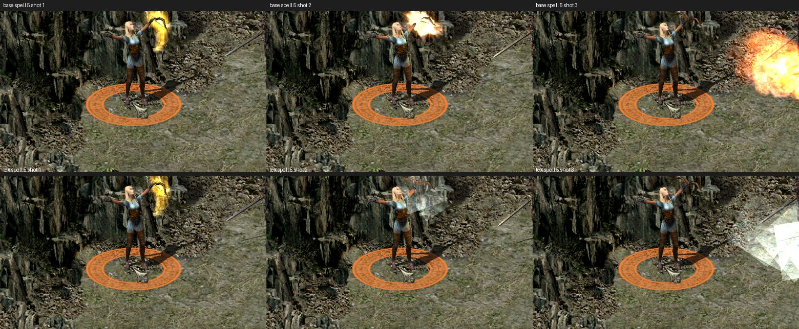

# Skill effects (`gear.pfx`)

What a mod can do with the particle effects of combat arts and spells: give an effect another colour, other sprites or another speed, and
choose that per cast, for instance "from skill level 10 on, red instead of green". The calls are in [GearApi.md](GearApi.md), section
"Skill effects"; the effect types and the texture names are in [GearPfxTypes.md](GearPfxTypes.md) (generated). Which effect types each combat art and
spell makes in game is in [GearPfxArtEffects.json](GearPfxArtEffects.json) (from an automated cast run of `src/gear/examples/pfxtable`).

```lua
-- The green effects of Poison Mist (spell 12) turn red from level 10 on.
gear.pfx.define({id = 9001, hue = -120})                    -- or colorize = 0xFF2020, multiply, alpha, speed, textures
gear.pfx.rule({fx = {0x318}, ability = 12, min_level = 10, use = 9001})

-- The same with code: any effect a creature of this mod's class casts, by its own rules.
gear.on('pfx.select', function(ctx)
    if ctx.creature and ctx.creature:class() == 'myclass' and ctx.level and ctx.level >= 10 then return 9001 end
end)
```





## What the game has

There is no effect table to add to. Every effect is an object of the class `cObjectFX` whose type is a number from 0x300 to 0x49D, and
`cObjectFX`'s setup (ENG `0x5A0C50`) turns the type into one of 182 hard-coded particle system classes (a byte table at `0x5A3570` picks a
switch case, which allocates and constructs the class). Each class holds its colours, textures, counts and timings in its own code; classes
that serve several types (the "ball", 0x419 to 0x41D) read the type in a switch for a colour. The arts and spells do not name an effect in their
records either: their handlers (`FUN_004FF0B0` for the arts, the spell handlers) create the effect objects with constant types. So a new
effect type or a new particle class cannot be made by data, and Gear does not try: it changes how one instance looks and runs.

The particle systems are kept by a manager (ENG `0x017EEBCC`, systems by a 16-bit handle that the effect object keeps at +0x6E); the manager updates
a system with the frame time (`0x7CC080`), and every class draws its sprites through one shared function (`0x761B00`) into a Direct3D 7 device.

## What a variant changes

| field | how | what it does |
|---|---|---|
| `speed` | the manager's update gets `dt * speed` | the particles, the fireball and the effect's whole duration run faster or slower (0.5 lasts twice as long). Everything that runs on the effect's own time follows; the cast animation of the hero does not. |
| `hue`, `colorize`, `multiply`, `alpha` | the colour of every vertex the system draws | `hue` turns the hue of every sprite colour by degrees (green +120 is blue, -120 is red); `colorize` makes saturated colours that colour at their own brightness (white cores stay white); `multiply` (0xAARRGGBB) multiplies; `alpha` fades. |
| `textures` | texture handles in the system's object | each name of the game's list can be replaced by another: `{PARTICLE_GLOW01.TGA = 'PARTICLE_SMOKE01.TGA'}`. The handle the engine's texture lookup gave the constructor is replaced inside the object (its size is known per type); a name the effect does not use changes nothing and the log says so. |

Colours are changed where the sprites are drawn, so what a texture has baked in stays (a green flame texture stays green under `multiply`; a grey
glow takes any colour). Two sprite functions are hooked: the batch drawing at 0x761B00 and the single-quad drawing at 0x7631E0 (ground discs and
magic circles, e.g. the cloud and circle of Poison Mist, type 0x318, class 0x17). The quads of the second one are mostly white and get their green from
the texture (FX_GROUNDPOISON.TGA), so `hue` and `colorize` leave that cloud green; recolour it with a `textures` swap or a `multiply` (which darkens it).
What a class draws by other code than the shared sprite function (not every class was checked; the hero's own spell overlays, models) is not touched.

## When it is decided

At the first update of a new effect. The effect object has its owner by then (+0x30: the creature that cast it, or the effect that made it) and
the level of the cast (+0xE4): the rules and the `pfx.select` handlers are asked once per effect with `{fx, creature, ability, level, parent}`. The
`creature` is the caster, found through the owner chain (an impact made by a projectile made by a cast still names the caster); `ability` is the art
or spell it has in flight; `level` is the cast level (for the first effects of a cast, which come before it is set, the creature's own level of the
ability). An effect made by an effect that has a variant takes the same variant unless a rule picks another, so a recoloured fireball makes
recoloured impacts. Effects whose owner chain reaches no creature (the engine's own, such as ambient ones) have no `creature` and no `ability`.

The check is done only for the effect types a rule names (a rule without `fx` and a `pfx.select` handler ask for every effect, which is one Lua call per new effect).

## Limits

* The effects are local. In a network game the other players see the engine's own look.
* The textures are the game's own (181 names, [GearPfxTypes.md](GearPfxTypes.md)): Gear cannot add a texture to the texture manager yet.
  The five types 0x380 to 0x384 are built by code of their own, their objects' size is unknown and `textures` does not apply to them.
* An effect cannot be given a new shape, count or lifetime other than through `speed`: those numbers are in the classes' code.
* Spawning an effect by itself is not offered: an effect object needs the cast event the arts and spells hand it, and without one it does not show.
* The type, class and size tables are generated from the English GOG `Sacred.exe` (`tools/gen_pfx_table.py`); the functions are found by signature as
  the rest of Gear's, and the signatures matched the German build too, but the effects were tested only in the English one.

## Tests

`src/gear/examples/pfxtest` (`Sacred.exe -gear-auto -gear-load=N -gear-mods=pfxtest`, a savegame with a Wood Elf, any level): the hero learns the spells 5 and
6 at level 5, casts them as the game does (the handler logs the effect types and owners), then with a colour rule, with a level rule that must and must not
match, with a `select` function and with a texture swap, taking screenshots 0.6, 1.4 and 2.4 s after each cast; 8 checks.

What the test found in game (Wood Elf, spells at level 5): spell 5 makes 0x317 and 0x30A (the glow in the hand; the fireball's effects), spell 6 0x317 and
0x30E, spell 12 0x318, spell 30 0x342, spell 2 (Steinhaut) 0x301, art 1005 0x35D. The orange ring on the ground is not a particle effect.
